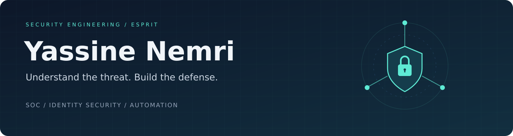

### Security Engineering Student · SOC · IAM · Security Automation

Building practical defenses, from Active Directory hardening to detection engineering and AI-assisted triage.

**📍 Bizerte, Tunisia · 🎓 ESPRIT**  
**Seeking a 6-month graduation internship · January / February 2027**

**Explore my projects in the pinned repositories below.**

### Certifications & badges

[View my complete Credly profile →](https://www.credly.com/users/yassine-nemri.0214c444)

  
  
  
  
  
  
  
  
  
  
  
  
  
  
  

<b>About me · Experience · Projects · Credential details · Toolbox</b>

## About

I'm **Yassine**, a Computer Science Engineering student specializing in **Network Infrastructure & Data Security**. I like working through the whole security workflow: build the environment, simulate an attack, investigate the evidence, and improve the defenses.

My main interests are **security operations, identity security, vulnerability management, and automation**. I'm also exploring how AI can support analysts while keeping security facts grounded in trusted evidence.

| Experience | Focus |
| :--- | :--- |
| **Attijari bank Tunisie** · Identity Security Intern | Active Directory hardening, PowerShell automation, attack simulation, and remediation. |
| **ACT** · Security Engineer Intern | SOC proof of concept on Sangfor infrastructure, MITRE ATT&CK-mapped detections, CIS assessments, and incident workflows. |
| **Groupe SFM** · DevSecOps Intern | Security automation and security checks across CI/CD workflows. |

## Projects

### 🛡️ Home SOC & AI-Assisted Triage

**Wazuh · Grafana · NetAlertX · Python · Ollama / Qwen3**

Built a home SOC that brings security alerts, device inventory, and local AI summaries into one workflow. Added custom Wazuh detections, auditd rules, and file integrity monitoring, then tested coverage through a **ten-scenario attack campaign**.

**Key lesson:** an AI model invented an ATT&CK mapping and altered a file hash during testing. I changed the design so paths, hashes, rule IDs, and technique mappings come from trusted alert data and lookup tables. AI summarizes the evidence and suggests next steps.

### ⚙️ LogMap — Log Onboarding CLI

**Python · Click · Rich · Splunk · Wazuh**

Built a CLI that detects log formats, extracts fields, validates parsing with match-rate previews, and generates **Splunk and Wazuh onboarding configurations**. Supports formats including JSON, CSV, Syslog, CEF/LEEF, and Cisco ASA.

### 🏥 CyberShield Health — Healthcare SOC

**Team project · Wazuh · Suricata · Zeek · n8n · TheHive · Cortex**

Contributed to an eight-month academic project with ESPRIT and Gérance Informatique: segmented infrastructure, centralized monitoring, threat enrichment, and automated incident response. The team integrated **MISP and OpenCTI** and developed healthcare-focused security playbooks.

[**Explore my portfolio →**](https://github.com/Yassine1Nemri/portfolio)

## Credentials

<b>Badge names and verification links</b>

- [AWS Academy Graduate - Cloud Security Foundations - Training Badge](https://www.credly.com/badges/3db440ae-d4bf-45ba-b70e-38188b8aea40)
- [Cyber Threat Management](https://www.credly.com/badges/e3a9bee5-64ac-4882-a03a-b5494c23e36b)
- [Endpoint Security](https://www.credly.com/badges/1a8c503d-60c5-4783-914a-152dac3d3e23)
- [Fortinet Certified Fundamentals Cybersecurity](https://www.credly.com/badges/4f9bf123-e60e-4600-8b61-54cb0303f902)
- [Fortinet FortiGate 7.6 Operator](https://www.credly.com/badges/68759be5-60b2-44a2-a2de-ced010168586)
- [Fortinet NSE 1 Certified in Cybersecurity](https://www.credly.com/badges/1d2d6163-da75-44b7-87ef-ae163572087a)
- [Fortinet NSE 2 Certified in Cybersecurity](https://www.credly.com/badges/11643122-7789-4e5e-985e-639cc2c03ca5)
- [Fortinet NSE 3 Certified in Cybersecurity](https://www.credly.com/badges/bd68a5bf-1549-44a3-8f28-5dc24b88fafa)
- [Governance, Risk, Compliance, and Data Privacy](https://www.credly.com/badges/4a55483e-91b9-4972-917a-928a7f394958)
- [Junior Cybersecurity Analyst Career Path](https://www.credly.com/badges/adc5ef49-b92c-4372-a354-300f129a8f23)
- [LFS158: Introduction to Kubernetes](https://www.credly.com/badges/220e9395-e426-4ccb-8436-edc8a76b42c0)
- [Multicloud Network Associate](https://www.credly.com/badges/3d8c9399-9768-4a5f-9042-cf999e43edd0)
- [Introduction to the Threat Landscape 3.0](https://www.credly.com/badges/918d9acd-2a21-4762-bce1-8959d11b207a)
- [Technical Introduction to Cybersecurity 3.0](https://www.credly.com/badges/99384378-9c66-4ec3-926a-e6e964444d9c)
- [ISC2 Candidate](https://www.credly.com/badges/cba907ce-628b-4621-a77c-7ecd9f177050) — candidate status.

### Selected certifications & applied skills

| Credential | Issuer |
| :--- | :--- |
| [**Certified Blue Team Practitioner — with Merit**](credentials/cbtp.png) | The SecOps Group |
| [**PCAP — Certified Associate Python Programmer**](credentials/pcap.jpeg) | Python Institute |
| [**Fortinet NSE 3 Certified in Cybersecurity**](credentials/fortinet-nse3.pdf) | Fortinet |
| [**Fortinet Certified Fundamentals in Cybersecurity**](credentials/fortinet-fcf.pdf) | Fortinet |
| [**ACE Multicloud Network Associate**](credentials/aviatrix-multicloud.pdf) | Aviatrix |
| [**Applied Skills: Administer Active Directory Domain Services**](credentials/microsoft-active-directory.pdf) | Microsoft |
| [**Applied Skills: Defend against cyberthreats with Microsoft Defender XDR**](credentials/microsoft-defender-xdr.pdf) | Microsoft |

<b>More learning: cloud security, AI, vulnerability management & governance</b>

 

| Training / credential | Issuer |
| :--- | :--- |
| [Cloud Security Foundations — AWS Academy Graduate training badge](https://www.credly.com/go/FzXkPWqR) | AWS Academy |
| [Junior Cybersecurity Analyst Career Path](credentials/cisco-junior-cybersecurity-analyst.pdf) | Cisco Networking Academy |
| [Vulnerability Management Foundations](credentials/qualys-vulnerability-management.pdf) | Qualys |
| [OWASP Top 10 LLM and GenAI — learning path completion](credentials/owasp-llm-genai.pdf) | See completion certificate |
| [Applications of AI for Anomaly Detection](credentials/nvidia-anomaly-detection.pdf) | NVIDIA |
| [Generative AI with Diffusion Models](credentials/nvidia-diffusion-models.pdf) | NVIDIA |
| [Governance, Risk, Compliance, and Data Privacy](https://www.credly.com/badges/4a55483e-91b9-4972-917a-928a7f394958) | IBM SkillsBuild |
| [Applied Skills: Implement retention, eDiscovery, and Communication Compliance in Microsoft Purview](credentials/microsoft-purview.pdf) | Microsoft |
| [Introduction to Network Analysis](credentials/network-analysis.pdf) | See completion certificate |
| [Hedera Certified Developer Associate](credentials/hedera-developer-associate.pdf) | Hedera |
| Introduction to Kubernetes — LFS158 | The Linux Foundation |

## Toolbox

**Detection & investigation**

**Identity, cloud & infrastructure**

**Code & automation**

## Beyond the terminal

Volunteering with **IEEE, Google Developers Group, and AIESEC** has helped me communicate technical ideas, work with different teams, and take ownership. I enjoy sharing lab findings and learning from the security community.

## Contact

I'm looking for a team where I can contribute to **SOC operations, IAM, vulnerability management, or security automation** while continuing to grow.

**Graduation internship: 6 months, starting January / February 2027.**

[**LinkedIn**](https://www.linkedin.com/in/yassine-nemri/) · [**Email**](mailto:Yassineelnemri@gmail.com) · [**Portfolio**](https://github.com/Yassine1Nemri/portfolio)

